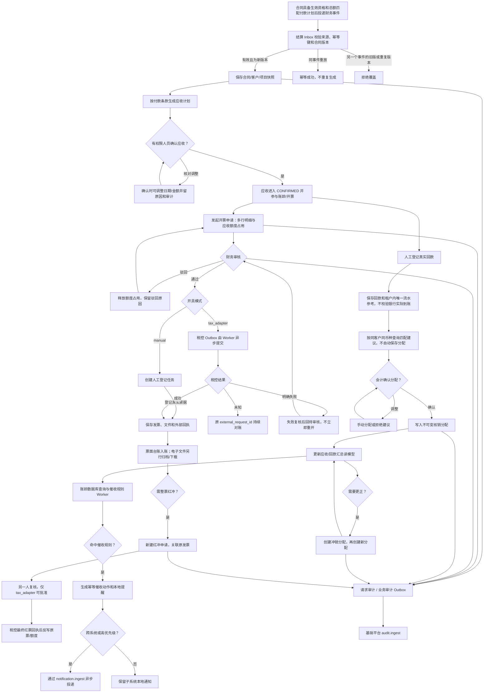

# 结算与开票管理子系统 — 当前业务流程图

2026-10-22 对照 API、业务事务、合同财务投递与 Worker 静态校准；不表示真实税控/银行或目标环境已验收。银行导入、ERP、电子票自动交付仍为设计目标，当前人工登记/下载见[操作手册](../../sharedDocs/10_操作手册/结算与开票操作手册.md)。

## 关键控制点

1. 合同生效以版本化事件为准；跨系统重复、乱序事件不得重复生成应收。
2. 开票占用的是“可开票额度”，审批驳回释放占用；当前不把取消当作已有用户入口。
3. 税控未知继续用原外部请求对账；明确失败的受控复核只回待审核，不自动重新开具。
4. 回款和核销确认后只能冲销，禁止更新或删除历史金额。
5. 催收按策略间隔生成新的幂等动作并升级，结清关闭/取消待办，余额恢复可重开；同一动作重试不重复生成财务事实。
6. 冲销导致结清失效时按应收期撤销或补偿实际结清信用事件；红票详情读取实际票面，符号/合计不符拒绝展示。
