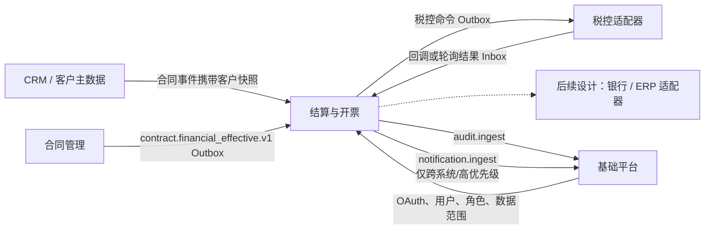
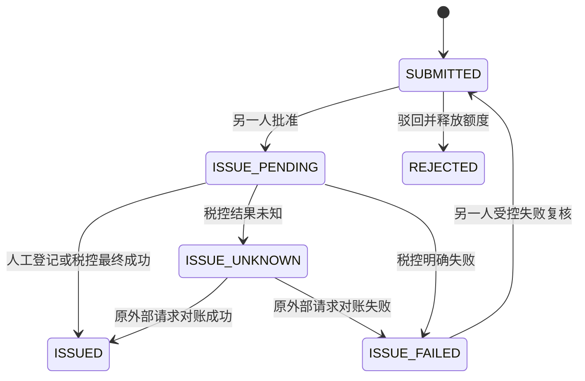

# 结算与开票管理子系统 — 实施设计与后续目标

本文保留领域设计与分期目标；2026-10-22 按当前源码校准已经落地的契约与状态，银行/ERP/期间控制等明确保留为后续设计，不代表已部署或已通过真实 Provider 验收。当前操作以[操作手册](../sharedDocs/10_操作手册/结算与开票操作手册.md)为准，实际表结构以 migrations 为准。

## 1. 定位与边界

结算与开票是独立的财务业务子系统，负责以下权威事实：

- 合同生效后形成的应收计划、应收确认与账龄；
- 开票申请、审批、税控开具尝试、电子票据、红冲/作废关系；
- 银行回款登记、回款分配、核销确认及冲销；
- 催收规则、催收案件和升级记录；
- 财务操作及外部交互的可审计证据。

它**不**创建或修改客户、项目、合同、组织、用户和角色。上述对象仍由 CRM、项目/合同管理和基础平台负责；本系统只保存带来源和版本号的业务快照。



## 2. 核心原则

1. **金额不可变、分录可冲销**：已确认回款、核销、开票及红冲不得直接改写或删除；修正以冲销/反向分录表达。
2. **上游只读快照**：跨库不得建立物理 FK；每个上游引用必须有 `source_system`、外部 ID、版本和快照时间。
3. **异步外部交互**：当前合同事件、税控命令/结果使用 Outbox/Inbox；银行导入、ERP 同步保留为后续设计，不能视为已装配。
4. **幂等优先**：所有命令有 `idempotency_key`；所有外部事件有稳定 `event_id`；回调有第三方流水唯一键。
5. **分权与审计**：申请、审批、开具、核销确认、冲销不能由同一职责无约束完成；所有高风险操作写审计。
6. **读写分离**：经营看板、账龄、TOP N 属于读模型/汇总，不作为账务事实来源。

## 3. 上游合同接入

合同侧已有人工付款计划、财务事务 Outbox 与补建/投递链。事件由审批生效事务或符合生效状态的补建任务产生，须有客户、合同编号、正金额/币种和合计匹配的付款计划；开关与机器凭据决定能否投递。当前 `ContractEvent` 契约示例：

```json
{
  "event_id": "...",
  "event_type": "contract.financial_effective.v1",
  "tenant_id": "...",
  "aggregate": {"id": "contract-id", "version": 12},
  "contract": {
    "id": "contract-id", "no": "HT-2026-001", "version": 12,
    "customer_id": "123", "customer_name": "示例客户",
    "currency": "CNY", "amount": "100000.00",
    "payment_terms": [{"installment_no": 1, "due_date": "2026-10-30", "amount": "100000.00"}]
  },
  "occurred_at": "2026-08-24T12:00:00Z"
}
```

结算系统用 `(tenant_id, source_system, source_event_id)` 去重，并仅接受大于当前快照版本的合同事件。旧事件不覆盖当前快照；撤销、变更、终止的完整财务补偿事件仍属后续契约设计，不能声称接收器已经支持这些事件。

当前实现边界：合同管理虽提供受保护的 `GET /internal/v1/settlement/completed-contracts` 摘要接口，但结算当前不以轮询该接口作为自动同步机制。正式联调必须使用带付款条款的 `contract.financial_effective.v1` 事件或明确的补偿任务；只有合同完成、没有付款条款或没有应收确认时，发票可选应收为空是正确结果。

## 4. 领域模型

### 4.1 应收

合同财务事件创建 `receivable_plan`，具备 `settlement.receivable.confirm` 的人员确认后生成可参与催收、开票与核销的 `receivable`；角色名称不能代替权限。单期确认可留痕调整，但不会自动重新校验所有期次合计。应收使用 `DECIMAL(18,2)` 与 `currency`；展示金额可四舍五入，账务计算不得使用浮点数。

```text
receivable.plan_amount
receivable.invoiced_amount     ← 发票分配汇总
receivable.cleared_amount      ← 已确认核销分配汇总
receivable.open_amount         = plan_amount - cleared_amount
receivable.invoiceable_amount  = eligible_amount - invoiced_amount - invoice_reserved_amount
```

### 4.2 开票

开票申请可包含多条服务/商品明细，并通过 `invoice_request_receivable_allocation` 占用可开票额度。审核通过后创建异步开具任务；税控回执、电子发票文件和红冲关系独立保存。



`ISSUE_FAILED` 不代表可自由新建第二张发票，必须先确定外部税控是否已受理；每次提交由 `invoice_issue_attempt` 持久化幂等键和外部流水号。税控投递成功只进入 `ACCEPTED`，最终结果由独立机器身份回调或状态查询对账写入 `tax_result_inbox`；UNKNOWN 必须复用原 external request，终态禁止回退。人工模式与税控模式互斥，人工模式下不得批准红冲。

上图是当前开票申请状态，不含设计稿旧 DRAFT/APPROVED/ISSUING/DELIVERED。失败复核要求税控有明确终态、无已开票、无 Provider 冲突、版本及复核原因合格，复核只回待审核，不立即开票。结果未知不得走该路径。

红冲由独立申请和 `invoice_red_flush_attempt` 跟踪。成功结果追加负数红票、实际票面明细、蓝红票关联与 allocation reversal，原蓝票事实不删除；重复、乱序和载荷冲突均保留 Inbox 证据并按 Provider 序号裁决。

### 4.3 回款与核销

回款是银行流水或人工登记的原始凭证；核销是回款与应收之间的不可变分配。一个回款可以分配到多张应收，一张应收也可以由多笔回款结清。

```text
receipt
  └── receipt_allocation (receipt_id, receivable_id, amount, status)
        └── receipt_allocation_reversal (reversed_allocation_id, reason)
```

当前匹配接口返回同客户同币种的建议和分值，不自动保存 PROPOSED 分配或规则版本；具备核销权限者确认后才保存 CONFIRMED 事实。冲销必须另一人执行并恢复两侧余额。应收从结清转未结清时按应收期定位当前结清信用事件并取消/补偿，不仅按被冲销分配查找；退款、发票红冲和合同回退均是不同业务。

### 4.4 催收与经营读模型

账龄由已确认应收和核销余额计算；催收使用版本化策略并按间隔产生后续动作、递增升级级别，结清关闭并取消待办，余额恢复可重开。看板、TOP N 和账龄汇总由受控数据库查询提供；CSV 才是异步任务，不将全部看板描述为异步读模型。

## 5. 集成与可靠性

| 场景 | 推荐实现 | 关键要求 |
|---|---|---|
| 合同生效 | 合同 Outbox → 结算 Inbox | event_id 去重、合同版本单调递增 |
| 税控开具 | 结算 Outbox → 税控适配 Worker | 外部幂等键、回调验签、失败/未知状态 |
| 银行回款（后续） | 文件导入或银行适配 Inbox | 当前仅人工回款登记；未来需流水唯一性、原始文件与重复校验 |
| ERP/总账（后续） | 已确认分录 Outbox | 尚未装配；未来需期间、批次、对账结果及重放能力 |
| 审计 | 请求审计 Outbox → 平台 `audit.ingest` | 不含账号、税号、完整银行号等敏感原文 |
| 重要通知 | 本地 Outbox → 平台 `notification.ingest` | 仅跨系统/HIGH/CRITICAL，使用平台 USER ID |

所有 Worker 使用已有的 MySQL 租约、`SKIP LOCKED`、指数退避、死信和人工重放模式。外部不可用只将业务对象置于可诊断的中间状态，不能回滚已经确认的财务事实。

报表查询必须走读模型或受控汇总；账龄导出采用异步 CSV 任务，不在 HTTP 请求中同步生成大文件。前端看板按页面分区加载目标接口，并用请求代次丢弃过期响应；单个接口失败必须在正式实现中可见，不能用旧状态静默替代。

## 6. 授权、数据范围与安全

建议建立独立权限，而非复用合同/CRM 的业务权限：

| 权限域 | 典型权限 |
|---|---|
| 应收 | `settlement.receivable.read`、`settlement.receivable.confirm` |
| 开票 | `settlement.invoice.read`、`settlement.invoice.request`、`settlement.invoice.approve`、`settlement.invoice.issue` |
| 回款与核销 | `settlement.receipt.record`、`settlement.allocation.confirm`、`settlement.allocation.reverse` |
| 催收与报表 | `settlement.dunning.manage`、`settlement.report.read`、`settlement.report.export`、`settlement.notification.read` |

以上权限以 `authz/permission-manifest.json` 为执行权威；设计稿中拟议的 `settlement.policy.manage`、`settlement.integration.operate` 不作为当前接入权限。

当前查询实施可信租户过滤与具体权限，尚未实现本设计目标中的组织、合同/项目负责人行范围。已存在税号等安全投影及下载/导出权限与审计，但不能把所有字段、复制或完整值查看都视为已有独立权限；进一步细粒度范围和脱敏属于后续设计。

## 7. 审计与期间控制

以下操作必须是高风险审计事件：开票审核、税控提交、人工补票、红冲、回款登记、核销确认、核销冲销、导出完整财务数据、催收升级规则变更。

后续支持财务期间：关闭期间后禁止新增/变更分录，只能用新的调整期间和冲销分录修正。报表导出记录筛选条件、生成时刻、操作者和文件校验值。

## 8. 分期实施

### 已实现基线（源码层面，外部验收另行进行）

- 合同财务事件 Inbox、合同快照、应收计划与权限确认；
- 开票申请、多明细、财务审核、人工开票登记和受控文件归档；
- 回款登记、人工/建议核销、部分核销、冲销；
- 基础账龄、内部催收、审计与本地通知；
- 关键账务命令幂等，财务事件与税控命令/结果使用 Outbox/Inbox；具体例外以 Handler 为准。

### 后续目标（尚未实现或尚需外部验收）

- 银行流水导入及自动持久化匹配；当前已有只读匹配建议；
- 真实税控/金税 Provider 沙箱及供应商验收；明确失败后的受控复核/重新审核已实现，不能据此证明真实 Provider 已验收；
- 电子票自动交付与部分红冲（当前仅支持整票红冲）；
- 跨系统高优先级通知已装配 Outbox，真实平台送达仍需运行验收。

### 第三期

- ERP/总账对接、财务期间锁定、月结与对账；
- 多币种、汇兑、坏账与高级账龄预测；
- 经营模型扩展；可配置催收策略及重复/升级/结清闭环已有实现。

## 9. 上线门槛

上线前必须完成：合同事件契约评审、税控/银行供应商边界确认、数据分类分级、财务权限矩阵、金额并发核销测试、事件重复/乱序测试、外部回调重放测试、审计抽查及财务人员验收。

当前代码级生产门禁还包括：

- `GET /auth/logout` 不得执行改变状态的登出操作；统一退出需完成 OIDC RP-initiated logout 和严格校验的 post logout URI；
- 明确 `invoiceable_amount` 是否受 `open_amount`、核销和冲销影响，并补齐边界测试；
- 看板不同权限下的部分失败、路由切换竞态和重复加载必须有行为测试，而不只依赖静态源码断言；
- 真实数据库测试必须通过合同事件→付款条款→应收确认→发票申请完成，不得直接插入模拟应收绕过业务校验。

已落实的查询安全门禁：合同快照、应收、催收案件之间的 JOIN 同时绑定租户；所有数据库行流在返回成功前检查 `rows.Err()`，避免跨租户脏关联和部分结果被误报为完整 200。
